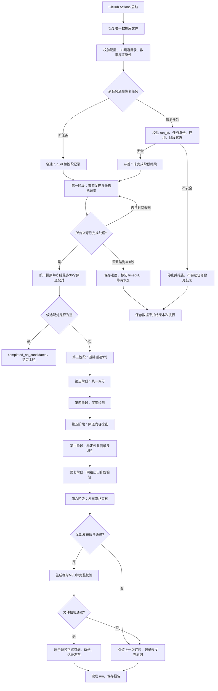

# China-IPTV-Auto：总流程图与施工图

- 版本：V3.0（全新数据库、单一自动化系统）
- 日期：2026-11-05
- 适用仓库：`womomo8/China-IPTV-Auto-v2`
- **本文件是全仓库唯一业务施工基准。**
- `docs/MASTER_PLAN.md` 只规定项目治理、施工顺序和验收办法；不得另行定义与本文件不同的业务规则。

## 0. 不可违反的总原则

1. 一个仓库、一条主流程、一个入口 `iptv_auto/pipeline.py`、一个数据库 `data/iptv_auto.sqlite3`、一份频道目录 `config/channels.yaml`、一份配置 `config.yaml`、一个正式出口 `output/result.m3u`。
2. 所有业务阶段由 `pipeline.py` 调度。模块只能执行被分配的工作，不得另建业务流程。
3. 所有阶段使用同一个 `run_id`、同一个数据库、同一份冻结候选名单。
4. 新系统从全新 V3 数据库开始，不开发 V1/V2 历史数据迁移，不读取旧版本业务数据作为本轮候选。
5. “不保留旧数据”不等于“每次运行清空数据库”。新数据库必须持续保存当前系统运行所需的来源池、来源检查、候选池、候选名单、阶段状态、检测结果和发布记录。
6. GitHub Actions运行机器是临时环境。必须在运行前恢复唯一数据库文件、运行后校验并保存同一数据库文件；不能把每次运行变成一套互不相干的空数据库。
7. 不删除仍被主流程、配置或测试引用的有效模块。清理必须先查依赖，再删除真正废弃的文件。
8. 38个正式频道以 `config/channels.yaml` 为唯一准则，未获确认不得增删或合并。
9. 未通过真实测试的功能不得标记完成；整体验收前不恢复定时任务。

## 1. 全系统流程总图

## 2. 统一任务和阶段状态

### 2.1 统一任务身份

每轮任务只有一个 `run_id`。至少记录：

- `run_id`
- `runner_identity`
- `environment_type`
- `pipeline_version`
- 配置摘要/配置哈希
- 38频道目录版本/摘要
- 开始、更新时间和结束时间
- 当前阶段、最终状态和摘要

恢复必须使用原 `run_id`，且验证运行身份、环境、配置/目录兼容性和阶段数据。验证失败就停止，不得自动创建新任务伪装成恢复。

### 2.2 统一阶段状态

仅允许以下状态：

- `pending`
- `running`
- `completed`
- `completed_no_candidates`
- `failed`
- `timeout`
- `skipped`

每个阶段必须持久化：输入范围、开始/结束时间、尝试次数、执行身份、环境、结果摘要、错误类型和恢复位置。

阶段完成后，先提交结果，再标记 `completed`，最后才能交接下游。`failed` 或 `timeout` 不得自动当作成功。

## 3. 第一阶段：来源发现、全量采集、候选池、统一冻结

### 3.1 来源发现

- 来源池目标容量：30个。
- 每轮最多新增发现来源：8个。
- 支持配置中的人工来源，人工来源优先处理。
- 第一阶段单次执行预算：最多480秒。
- 单次网络请求超时：8秒。
- 所有来源统一登记到 `sources`，来源池去重并执行黑名单检查。
- 每个来源在本轮有独立处理状态；已完成来源恢复时不得重新抓取。
- 来源抓取成功或失败都要记录状态、耗时、HTTP状态、解析数和错误原因。

### 3.2 采集和准入

每个来源完成抓取后：

1. 解析支持的订阅格式。
2. 标准化URL、请求头和频道名称。
3. 只匹配 `config/channels.yaml` 中的38个正式频道。
4. 执行空地址、占位地址、协议和IPv4准入规则。
5. 执行线路/URL黑名单检查。
6. 以 `(line_id, channel_id)` 去重写入本轮临时候选池。
7. 对同一个配对保留全部来源关系。
8. 保存URL、请求头、正式频道名称、分类和准入证据快照。

**在全部来源处理完之前，不得因先到的来源而提前占满36个最终名额。** 这可避免早期来源垄断候选位置。

### 3.3 候选池与冻结

建议数据库表：

- `run_candidate_pool`：本轮所有通过初筛的线路/频道配对及快照。
- `run_candidate_pool_sources`：每个配对对应的全部来源关系。
- `run_candidates`：最终冻结名单。
- `run_candidate_sources`：最终入选配对对应的来源关系。

冻结规则：

1. 等待本轮所有计划来源处理完成。若480秒到达但仍有来源未完成，不冻结；保存候选池和来源进度，标记 `timeout`，下次恢复只处理未完成来源。
2. 全部来源处理完成后，对候选配对统一排序。
3. 排序优先级：来源数量从高到低；有真实记录的来源可靠性作为次级因素；最后以 `line_id`、`channel_id` 稳定排序。
4. 最多冻结36个**线路/频道配对**。36不是物理线路数。
5. 同时统计并记录：候选配对数、不同物理线路数、来源数、拒绝数。
6. 冻结完成后名单不可增加、删除或重排。恢复任务只能读取原名单。
7. 如果无合格配对，记录 `completed_no_candidates`，正常结束本轮。

## 4. 第二阶段：基础测速

- 只读取当前 `run_id` 的 `run_candidates`。
- 以不同物理 `line_id` 为单位测速，同一物理线路关联多个频道时不重复测速。
- 每条线路完成3轮基础测速。
- 单次超时8秒，并发最多12。
- 每轮记录真实状态、延迟、吞吐、环境、执行身份和错误证据。
- `pending` 可恢复；已完成轮次不得重复占位或伪造成功。
- 不允许查询全库线路来扩大本轮测速范围。

完成条件：本轮冻结名单中所有需测物理线路都已完成规定轮次，或被明确记录为失败/受限；结果已提交。

## 5. 第三阶段：统一评分

评分只使用本轮真实测速数据和本轮冻结配对：

| 指标 | 权重 |
|---|---:|
| 成功率 | 30 |
| 稳定性 | 25 |
| 吞吐能力 | 15 |
| 新鲜度 | 15 |
| 广告占位风险 | 10 |
| 来源可靠性 | 5 |
| 合计 | 100 |

等级：A≥85；B为70–84；C为50–69；低于50不进入优质候选池。

- 线路级分数按物理线路计算。
- 频道候选资格必须从本轮 `(line_id, channel_id)` 配对产生。
- 来源可靠性只能使用有证据的来源历史，不得编造或将全库历史线路引入本轮。
- 每个正式频道最多选5个优质候选配对进入深度检测。

## 6. 第四阶段：深度检测

- 只接受本轮评分阶段选出的精确候选配对。
- FFmpeg/FFprobe检测；单次超时目标25秒；并发最多3。
- 同一物理线路可以只解码一次，避免重复成本。
- 线路级FFprobe通过只证明媒体流可解析，**不代表该线路对应的每个频道内容都匹配**。
- 记录检测状态、音视频流、分辨率、编码、时长和证据。
- 失败/未知必须保留原因，不得自动变成通过。

## 7. 第五阶段：频道内容检查

- 按 `(run_id, line_id, channel_id)` 配对检查，不得仅按 `line_id` 去重后丢失其他频道。
- 读取冻结候选快照，不依赖可能变化的全局频道关联表重新推断身份。
- 检查频道是否匹配、广告占位、错误画面、空画面和无效内容。
- 每个配对独立保存检查状态和证据，建议使用 `run_candidate_checks`，避免把频道级判断写入线路级 `deep_probes`。
- 临时网络异常标记为未知/待复核，不等同于永久失效。
- 只有确认的广告占位或确认无效内容，才能按规则进入黑名单。

## 8. 第六阶段：稳定性复测

- 最多2轮。
- 仅处理本轮通过必要深度检测和频道内容检查的候选。
- 线路级稳定性测速可按物理线路去重；频道配对资格仍需分别保留。
- 支持 `pending` 恢复，最多两轮，不无限重试。
- 拥堵、卡顿、短暂断流主要影响评分；不能仅凭一次短暂异常永久拉黑。

## 9. 第七阶段：网络出口身份验证

明确区分：

1. GitHub Actions云端检测出口。
2. 国内真实IPv4出口。
3. 福建移动真实家庭网络出口。

没有真实福建移动家庭网络测试条件时，结果必须是“未验证”。云端检测、DNS判断或其他运营商结果不得冒充福建移动家庭网络验证。

## 10. 第八阶段：发布审核与安全发布

每条发布线路必须同时满足：

- 最近一次测量成功；
- 完成3轮基础测速；
- 成功率≥90%；
- 综合评分≥70；
- FFprobe通过；
- 对应频道内容检查通过；
- 无确认广告占位或无效内容；
- 网络出口身份如实标记。

每个频道最多发布3条。发布顺序按质量分数和稳定规则确定。

发布过程：

1. 生成临时M3U。
2. 检查M3U格式、频道身份、URL、重复项和每频道数量。
3. 全部通过后，在同一文件系统内原子替换 `output/result.m3u`。
4. 替换前备份上一版到 `output/backups/`。
5. 写入 `publications` 记录和SHA-256。
6. 任一检查失败，保留上一版正式订阅，不覆盖。

正式地址规划：`https://raw.githubusercontent.com/womomo8/China-IPTV-Auto-v2/main/output/result.m3u`。只有文件实际存在并通过发布验收后，才可称为正式可用。

## 11. 统一数据库结构职责

唯一数据库：`data/iptv_auto.sqlite3`。

数据库只保存新系统运行所需数据，不迁移V1/V2历史业务记录。建议按职责划分：

| 数据域 | 表 |
|---|---|
| 任务与阶段 | `runs`、`run_stages` |
| 来源池与来源检查 | `sources`、`source_checks`、`source_scores` |
| 线路和频道主数据 | `lines`、`channels`、`source_lines`、`line_channels` |
| 本轮临时候选池 | `run_candidate_pool`、`run_candidate_pool_sources` |
| 本轮冻结候选 | `run_candidates`、`run_candidate_sources` |
| 测速和线路评分 | `measurements`、`line_scores` |
| 深度检测和频道检查 | `deep_probes`、`run_candidate_checks` |
| 黑名单与发布 | `blacklists`、`publications` |

所有本轮业务数据必须带 `run_id` 或通过外键关联本轮候选。所有查询必须明确限定本轮范围。

数据库首次初始化只允许创建完整V3结构。发现非空且结构不符合V3的数据库时，停止并报告；不自动迁移、不猜测修补。切换V3时由施工步骤明确移除旧数据库Artifact，随后由新版本创建空库。此后每轮复用同一V3数据库。

## 12. 恢复规则

- 每个来源完成抓取、解析、候选入池和来源检查记录后，才标记该来源完成。
- 若执行中断，恢复时不重复处理已完成来源。
- 第一阶段未完成且尚未冻结：恢复未完成来源，完成后统一冻结。
- 候选已冻结：后续阶段只读原冻结名单，禁止重新发现来源或更改候选。
- 某阶段已完成：恢复时跳过，不重复执行。
- 某阶段 `running` 且没有可恢复的内部任务：按安全规则将未完成工作重新排队，但不得重复已确认完成的工作。
- `runner_identity`、`environment_type`、配置摘要、频道目录摘要或候选快照校验不一致时，停止并报告。
- 不允许通过新建 `run_id` 伪装成恢复旧任务。

## 13. 全仓库文件职责

| 文件/目录 | 唯一职责 |
|---|---|
| `README.md` | 简介、使用方式、指向本施工图 |
| `docs/CORE_FLOW.md` | 唯一业务流程和施工准则 |
| `docs/MASTER_PLAN.md` | 项目治理、施工批次、测试和验收记录 |
| `config.yaml` | 唯一运行参数 |
| `config/channels.yaml` | 唯一38频道目录 |
| `iptv_auto/pipeline.py` | 唯一业务编排入口 |
| `iptv_auto/database.py` | 唯一数据库结构、连接和初始化 |
| `iptv_auto/*.py` | 被主流程调用的单一职责模块 |
| `tests/` | 单元、集成和端到端测试 |
| `.github/workflows/iptv-auto.yml` | 安装环境、测试、恢复/保存唯一数据库、启动主程序 |
| `output/result.m3u` | 唯一正式订阅 |
| `output/backups/` | 正式订阅回滚备份 |
| `logs/` | 运行日志，不作为第二数据库 |

## 14. 本版实施状态（基准，不代表完成）

- 已确认：当前主分支数据库为V2，含 `run_candidates`、`run_candidate_sources`、`run_stages`，没有候选池和频道级检查表。
- 已确认：第一阶段当前逐来源提前占用36个名额，未做到全部来源采集后统一排序。
- 已确认：当前恢复入口仍会重新执行来源发现。
- 已确认：测速、评分、内容检查、稳定性代码仍存在读取全局线路/频道关系的路径，需要改成当前run冻结候选。
- 已确认：当前主流程只到 `awaiting_publication`，网络出口验证和正式发布尚未接入完整主流程。
- 未验收：完整自动化主流程、断点恢复、网络出口验证、正式发布和定时运行。
